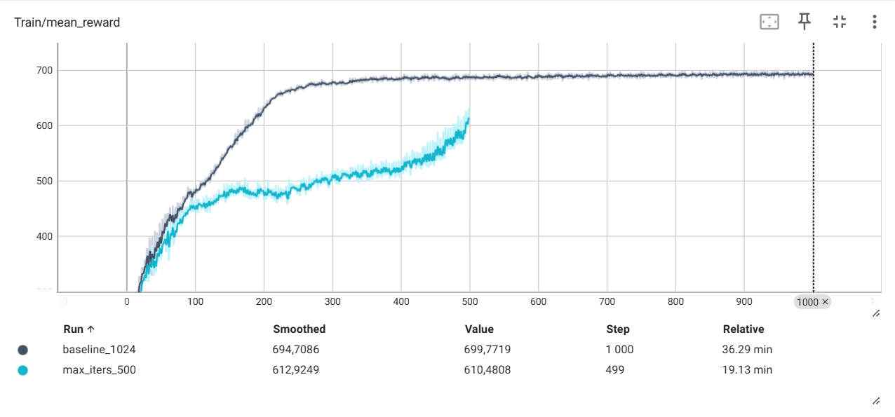

# Эксперименты с обучением PandaPickCube

Учебный проект: влияние масштаба обучения и весов награды на поведение PPO-политики.
Исходный код взят из [Yandex-Practicum/ap-physicalai-1](https://github.com/Yandex-Practicum/ap-physicalai-1). Эксперименты, изменения шага физики, результаты и анализ выполнены в рамках практики.

## Условия

Обучение: Google Colab, Tesla T4, Python 3.13.16. Проверка: локальный CPU-контейнер, 10 эпизодов, seed=42 (эпизоды 42–51).
Во всех пяти запусках NUM_ENVS=1024, SEED=1, sim_dt=0.0025, learning_rate=0.001, адаптивный schedule PPO. Архитектуры актора и критика: [512,256,128], ELU.
Baseline здесь отличается от дефолтного запуска курса: число сред уменьшено ради времени, шаг физики уменьшен после NaN в предыдущей практике. Эти настройки сохранены одинаковыми во всех пяти опытах. Baseline оказался слабым — SR=0/10.

Основные версии Colab: torch 2.8.0+cu126, jax/jaxlib 0.6.2, playground 0.1.0, rsl-rl-lib 5.5.1, mujoco/mujoco-mjx 3.5.0, numpy 2.2.6. Зависимости не зафиксированы полным lock-файлом; побитовая воспроизводимость не гарантируется.

## Результаты

SR — число эпизодов с расстоянием куба до цели меньше 0.05 м в конце эпизода. Это не число захватов. Все обучения запускались с нуля в Colab, команды CLI обучения не применялись.

| Эксперимент | Изменение относительно baseline | mean_reward обучения | SR | Δ reward | Δ SR, эпизодов | Время, с |
|---|---|---:|---:|---:|---:|---:|
| baseline_1024 | — | 699.77 | 0/10 | — | — | 2323 |
| max_iters_500 | MAX_ITERS = 500 вместо 1001 | 610.48 | 0/10 | −89.29 | 0 | 1297 |
| box_target_strong | env_cfg.reward_config.scales.box_target = 40.0 | 734.72 | 0/10 | +34.95 | 0 | 2463 |
| qpos_strong | env_cfg.reward_config.scales.robot_target_qpos = 30.0 | 4523.88 | 0/10 | +3824.11 | 0 | 2095 |
| gripper_box_2 | env_cfg.reward_config.scales.gripper_box = 2.0 | 938.18 | 10/10 | +238.41 | +10 | 2380 |

Во всех опытах, кроме max_iters_500, MAX_ITERS=1001. Имена EXP_NAME совпадают с именами строк. Вес награды меняется только один за раз. Увеличение абсолютной награды при разных весах не является единой шкалой качества.

[Excel с таблицей и анализом](reports/observations.xlsx) · [CSV](reports/results.csv)

## Поведение и сравнение

- Baseline: тянется и обхватывает куб, но не поднимает и не доставляет его к цели.
- 500 итераций: тянется к кубу, но не берёт его. Время снизилось на 44.2%, награда — на 12.8%. Baseline вышел на плато примерно после 300 итераций; короткий запуск к концу ещё рос. Кривые различались и на общем отрезке: эффект нельзя полностью отделить от случайности по одному запуску.
- box_target_strong: хуже подводит гриппер, может сомкнуть пальцы мимо куба. Усиление основной компоненты не дало ожидаемого роста SR.
- qpos_strong: почти неподвижен и не наклоняется к кубу. Большая награда за сохранение позы стала выгоднее выполнения задачи.
- gripper_box_2: по измерениям поднимает куб и достигает цели во всех десяти эпизодах. Дистанции до цели: 0.022, 0.031, 0.019, 0.047, 0.030, 0.037, 0.016, 0.027, 0.030, 0.027 м.

Масштаб меняет объём опыта и время, вес основной компоненты — приоритет части задачи, вес вспомогательной — баланс между задачей и регуляризацией поведения. Среди первых четырёх опытов SR одинаков (0/10), поэтому по нему нельзя выделить наиболее сильную модификацию. По поведению наиболее заметен qpos_strong, по абсолютной награде обучения он также максимален. Но сильнейшее улучшение реального выполнения задачи среди всех пяти дал gripper_box_2: 0/10 → 10/10. Десять эпизодов и один обучающий запуск не доказывают универсальность эффекта.

## Самостоятельный эксперимент: гипотеза и вывод

**Вопрос:** поможет ли уменьшение награды за одно лишь приближение освоить перенос?

**Гипотеза до запуска:** если уменьшить gripper_box с 4 до 2, то ожидается снижение mean_reward относительно 699.77, но увеличение SR хотя бы до 1/10: приближение без доставки станет менее выгодным относительно достижения цели. Риск — ухудшение самого подхода к кубу.

**Результат:** mean_reward=938.18, SR=10/10, время 2380 с. Гипотеза по SR подтвердилась на десяти проверенных эпизодах, по снижению награды — нет: награда выросла на 238.41. Возможное объяснение — освоение переноса увеличило вклад box_target, компенсировав уменьшение награды за подход. Это объяснение согласуется с логами, но требует повторов для подтверждения причинности.

Средние награды инференса при одинаковых исходных весах: 701.44, 680.29, 466.66, 106.82 и 1302.12 соответственно. Эти значения не заменяют mean_reward обучения в таблице.

## Материалы

- `logs/<эксперимент>/`: фактические config.json и env_config.json, финальный чекпоинт, события TensorBoard и evaluation.json с перенесённым итогом терминала.
- [Видео успешной политики](logs/gripper_box_2/video.mp4).
- [Кривая baseline](reports/baseline_curve.png).
- [Сравнение кривых](reports/comparison_curves.png).



## Повторение

1. Загрузить `train_experiments.ipynb` в Colab, выбрать T4. Это очищенная и упорядоченная копия рабочего ноутбука, подготовленная после опытов; обучение повторно при упаковке не запускалось.
2. Выполнить установку, обычный перезапуск сеанса, подключение Google Drive, проверку GPU. Затем выбрать EXPERIMENT и запустить обучение. Папка на Диске: `physicalAI/logs/<имя>`.
3. Скачать результаты в локальную `logs/`. В существующем CPU-контейнере из `/workspace` выполнить:

```bash
python3 inference.py --checkpoint logs/gripper_box_2/model_1000.pt --episodes 10
python3 inference.py --checkpoint logs/gripper_box_2/model_1000.pt --record logs/gripper_box_2/video.mp4 --episodes 3
```

Для max_iters_500 финальный файл — model_499.pt, для остальных — model_1000.pt. Включённый inference.py использует sim_dt=0.0025 в обоих местах создания среды. Веса награды на инференсе остаются исходными для одинаковой оценки, SR использует расстояние до цели.

`train.py` сохранён как исходный локальный способ обучения и не отражает автоматически выбор эксперимента Colab. Для воспроизведения этой серии используйте ноутбук и сохранённые конфигурации. `environment/`, `scripts/`, `tests/` — инфраструктура исходного проекта; повторную сборку Docker в ходе оформления не выполняли.

## Поиск параметров

| Параметр | Где | Ключ / флаг | По умолчанию |
|---|---|---|---|
| num_envs | train.py, device_utils.py | --num_envs, default_num_envs | argparse=None; 4096 CUDA, 64 CPU |
| learning_rate | manipulation_params.rsl_rl_config | algorithm.learning_rate | 0.001 |
| max_iters | train.py | --max_iters | 1001 |
| gripper_box | registry.get_default_config | reward_config.scales.gripper_box | 4.0 |
